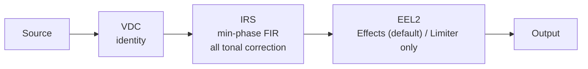

<div align="center">


# HyperAudio

**Measurement-driven DSP correction chains for two specific playback systems.**<br>
Built for [RootlessJamesDSP](https://github.com/ThePBone/RootlessJamesDSP).

<br>

[](https://nmstudioo.github.io/HyperAudioo/)

<br>


<sub>[Overview](#overview) · [Devices](#devices) · [Architecture](#architecture) · [Site](#the-site) · [Quick start](#quick-start) · [Docs](#documentation) · [Validation](#validation-state) · [Limitations](#known-limitations)</sub>

<br>


</div>

<br>

## Overview

Each chain is a matched set: an identity **VDC**, a minimum-phase **IRS** that carries the correction, and an **EEL** script. The IEM EEL defaults to Effects, with a selectable Limiter only path.

This is **not** a preset collection. Every claim in this repository carries an evidence label, and unverified items are marked as such. See [`docs/methodology.md`](docs/methodology.md).

<table>
<tr>
<td align="center" width="25%"><b>2</b><br><sub>device chains</sub></td>
<td align="center" width="25%"><b>3</b><br><sub>files per chain</sub></td>
<td align="center" width="25%"><b>48 kHz</b><br><sub>host rate only</sub></td>
<td align="center" width="25%"><b>1</b><br><sub>place for tonal correction: the IRS</sub></td>
</tr>
</table>

## Devices

<table>
<tr>
<td width="50%" valign="top">

### 🔊 Redmi 12 · Speaker

`Redmi_12/` · **V6 · frozen**

8192-tap IRS · 48 kHz<br>
Transparent post-IRS limiter, with no EQ, bass synthesis or stereo processing.

[Setting guide](Redmi_12/Setting_Guide_S.md) · [Report](Redmi_12/report_Redmi_12.md)

</td>
<td width="50%" valign="top">

### 🎧 KZ EDX Pro · IEM

`edx_pro/` · **v3 IRS · v5 EEL**

2048-tap IRS · 48 kHz · 24 Ω, 112 dB/mW<br>
Selectable Effects or Limiter only. Tames the 5 kHz and 8 kHz treble traits and restores vocal presence.

[Setting guide](edx_pro/Setting_Guide_IEM.md) · [Report](edx_pro/report_EDX_HA.md)

</td>
</tr>
</table>

## Architecture



> [!IMPORTANT]
> Tonal correction lives **only in the IRS**. Never load the same EQ in both the VDC and the convolver, because it applies twice.

## The site

**[nmstudioo.github.io/HyperAudioo](https://nmstudioo.github.io/HyperAudioo/)** is a static page with no build step. All computation runs locally in your browser.

| | |
|---|---|
| **Profiles** | Switch between the KZ EDX Pro and the Redmi 12 speaker. |
| **Response chart** | Frequency response measured from the hosted IRS: log frequency, 1/6-octave smoothed, hover or arrow keys for readout. |
| **Quality assurance** | The hosted IRS, VDC and EEL are fetched and checked in your browser. Downloads are blocked if QA fails. |
| **Export** | Download the three files, or copy a 127-point GraphicEQ curve derived from the IRS. |
| **Verification harness** | Offline checks on both chains. Not app, ARM or device validation. |
| **Docs reader** | Every document in this repository opens inside the site. Deep links look like `#read/docs/methodology.md`. |

## Quick start

1. **Host rate 48 kHz.** Both IRS files are 48 kHz only. Verify the *running* rate in Rootless.
2. **Disable** every other EQ, bass boost and OEM sound effect.
3. **Load in this order:** DDC (`.vdc`) → Convolver (`.irs`, preamp **0 dB**) → Liveprog (`.eel`).
4. **Start at low volume.**

<table>
<tr>
<td width="50%" valign="top">

**🔊 Redmi 12** · `Redmi_12/`

- `HA_Speaker_Master.vdc`
- `HA_Speaker_Master.irs`
- `HA_Speaker_Master.eel`

</td>
<td width="50%" valign="top">

**🎧 KZ EDX Pro** · `edx_pro/`

- `HA_IEM_v3.vdc`
- `HA_IEM_v3.irs`
- `HA_IEM_v3.eel`

</td>
</tr>
</table>

## Documentation

- [VDC reference](docs/vdc_functions.md)
- [IRS reference](docs/irs_functions.md)
- [EEL2 reference](docs/eel_functions)

| Document | Read on the site | Source |
|---|---|---|
| Methodology | [Open](https://nmstudioo.github.io/HyperAudioo/#read/docs/methodology.md) | [`docs/methodology.md`](docs/methodology.md) |
| Test report | [Open](https://nmstudioo.github.io/HyperAudioo/#read/docs/test_report.md) | [`docs/test_report.md`](docs/test_report.md) |
| IEM setup guide | [Open](https://nmstudioo.github.io/HyperAudioo/#read/edx_pro/Setting_Guide_IEM.md) | [`edx_pro/Setting_Guide_IEM.md`](edx_pro/Setting_Guide_IEM.md) |
| Speaker setup guide | [Open](https://nmstudioo.github.io/HyperAudioo/#read/Redmi_12/Setting_Guide_S.md) | [`Redmi_12/Setting_Guide_S.md`](Redmi_12/Setting_Guide_S.md) |
| EDX Pro report | [Open](https://nmstudioo.github.io/HyperAudioo/#read/edx_pro/report_EDX_HA.md) | [`edx_pro/report_EDX_HA.md`](edx_pro/report_EDX_HA.md) |
| Redmi 12 report | [Open](https://nmstudioo.github.io/HyperAudioo/#read/Redmi_12/report_Redmi_12.md) | [`Redmi_12/report_Redmi_12.md`](Redmi_12/report_Redmi_12.md) |
| Attribution | [Open](https://nmstudioo.github.io/HyperAudioo/#read/ATTRIBUTION.md) | [`ATTRIBUTION.md`](ATTRIBUTION.md) |

### Verification harness reports

<p align="center">
  
  
</p>

## Validation state

| Component | Offline checks | App / device | Listening |
|---|:-:|:-:|:-:|
| Speaker VDC | ✅ identity | 🟡 USER REPORTED | 🟡 USER REPORTED |
| Speaker IRS | ✅ PASS | 🟡 USER REPORTED | 🟡 USER REPORTED |
| Speaker EEL | 🟡 PASS (compile, ceiling, bypass); non-finite rerun pending | 🟡 USER REPORTED | 🟡 USER REPORTED |
| IEM VDC | ✅ identity | — | — |
| IEM IRS | ✅ PASS | ⛔ NOT RUN | ⛔ NOT RUN |
| IEM EEL effects path | ✅ prior v4 checks (effects, ceiling, bypass, non-finite) | ⛔ NOT RUN | ⛔ NOT RUN |
| IEM EEL v5 mode selector | 🟡 source review only; VM retest pending | ⛔ NOT RUN | ⛔ NOT RUN |

*Numerically qualified* never implies device testing or listening. Offline = source-built JamesDSP VM on x86_64, not ARM and not the app. Details: [`docs/test_report.md`](docs/test_report.md).

## Integrity

Verify downloads with `sha256sum`.

<details>
<summary><b>SHA-256 checksums</b></summary>

```
Redmi_12/HA_Speaker_Master.vdc
    933be0b02daead88450f2042065d0fb5a44e77099f8c29a6e37b9669e6a2d6ef
Redmi_12/HA_Speaker_Master.irs
    0ba8da0f4351aca761e3c7e39b37bccf9b61403f7d92ed60ecf1b23cda0c7de4
Redmi_12/HA_Speaker_Master.eel
    e5cfbc49cb82aad8d3c45da5ca27715a9712639cb1f41aa3dce2a9677c903af4

edx_pro/HA_IEM_v3.vdc
    933be0b02daead88450f2042065d0fb5a44e77099f8c29a6e37b9669e6a2d6ef
edx_pro/HA_IEM_v3.irs
    b6d751a1613b48569a6ec485f477603172dcc14b0072f0c86c93b4668363b9d5
edx_pro/HA_IEM_v3.eel
    3efa4976c3e9788faafa0225a9bcffa5944c04cb3d1bbfd5b64ce3a6d7d56b17
```

</details>

## Known limitations

> [!WARNING]
> Read these before relying on any chain.

- **Reproducibility:** `iem_build.py` / `generate_irs.py` and complete source inputs are not included. The published IRS cannot be regenerated from this repository alone.
- **Speaker IRS provenance:** the measurement setup is not documented here. If a mic's response was inside it, it is inside the filter.
- **IEM voicing has no measurement behind it.** It is a labelled design choice.
- **Not Dolby.** The IEM surround is crossfeed plus width, not HRTF virtualisation.
- **ARM unverified.** All EEL tests ran on x86_64. The v5 processing-mode selector has not yet been VM- or device-tested.
- **Sample-peak limiting** is not true-peak or excursion protection.
- **48 kHz only.** At any other rate the IRS is stretched or shortened.

## Repository structure

<details>
<summary><b>Show file tree</b></summary>

```
hyperaudioo/
├── LICENSE                   Licensing summary and pointers
├── LICENSE-MIT               Code (EEL2)
├── LICENSE-CC-BY-SA-4.0      Audio artifacts (.irs, .vdc, reports)
├── ATTRIBUTION.md            AutoEq, Speaker Ranking, RootlessJamesDSP
├── README.md                 This file
├── index.html                The site
├── favicon.ico               Favicon (16, 32, 48)
├── site.webmanifest          Web app manifest
├── robots.txt                Crawler rules
├── sitemap.xml               Sitemap
│
├── Redmi_12/
│   ├── HA_Speaker_Master.eel     Post-IRS transparent limiter
│   ├── HA_Speaker_Master.irs     8192-tap FIR correction
│   ├── HA_Speaker_Master.vdc     Identity DDC (no correction)
│   ├── Setting_Guide_S.md        On-device setup instructions
│   └── report_Redmi_12.md        Numerical report
│
├── edx_pro/
│   ├── HA_IEM_v3.irs             2048-tap minimum-phase FIR correction
│   ├── HA_IEM_v3.eel             Selectable effects / limiter-only paths (EEL2)
│   ├── HA_IEM_v3.vdc             Identity DDC (no correction)
│   ├── Setting_Guide_IEM.md      On-device setup instructions
│   └── report_EDX_HA.md          Numerical report
│
├── docs/
│   ├── methodology.md            Synthesis, gating, validation method
│   └── test_report.md            Test results and open questions
│
├── assets/
│   ├── script.js                 Analysis, chart, QA and downloads
│   ├── docs.js                   In-page markdown reader
│   ├── style.css                 Design tokens and layout
│   ├── fonts/                    Inter Tight, Geist Mono (woff2, self-hosted)
│   ├── banner.svg                Repository cover
│   ├── og-image.png              Social preview (1280×640)
│   ├── logo.svg                  Brand mark
│   ├── icon-192.png              App icon
│   ├── icon-512.png              App icon
│   ├── icon-maskable-512.png     Maskable app icon
│   ├── apple-touch-icon.png      iOS home screen icon
│   ├── favicon-32.png            Favicon
│   ├── Speaker_AB_Harness.webp   Speaker harness report
│   └── IEM_AB_Harness.webp       IEM harness report
│
└── .github/workflows/ci.yml      Syntax, HTML and Lighthouse checks
```

</details>

## License

| Scope | License |
|---|---|
| Code (`.eel`) | [MIT](LICENSE-MIT) |
| Audio artifacts (`.irs`, `.vdc`, reports) | [CC BY-SA 4.0](LICENSE-CC-BY-SA-4.0) |

## Credits

See [`ATTRIBUTION.md`](ATTRIBUTION.md). Presets derive from AutoEq-format data (jaakkopasanen/AutoEq, MIT) via RikudouGoku's database, corroborated by Speaker Ranking. EEL2 scripts target the VM in RootlessJamesDSP (ThePBone, Apache 2.0). No third-party code or raw measurements are redistributed.

<br>

<div align="center">

<sub>Designed &amp; tuned by <b>Noushad M.</b> · © 2026</sub>

</div>
