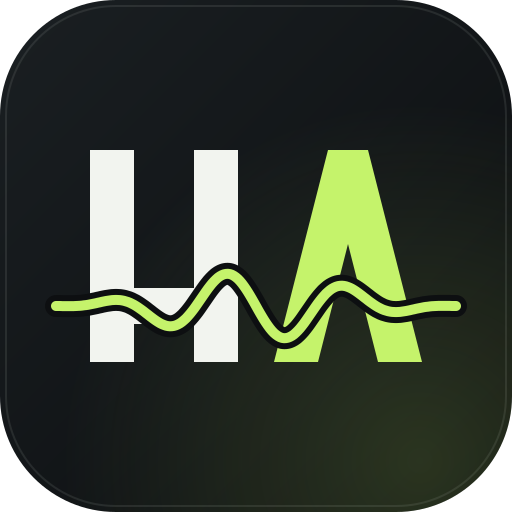
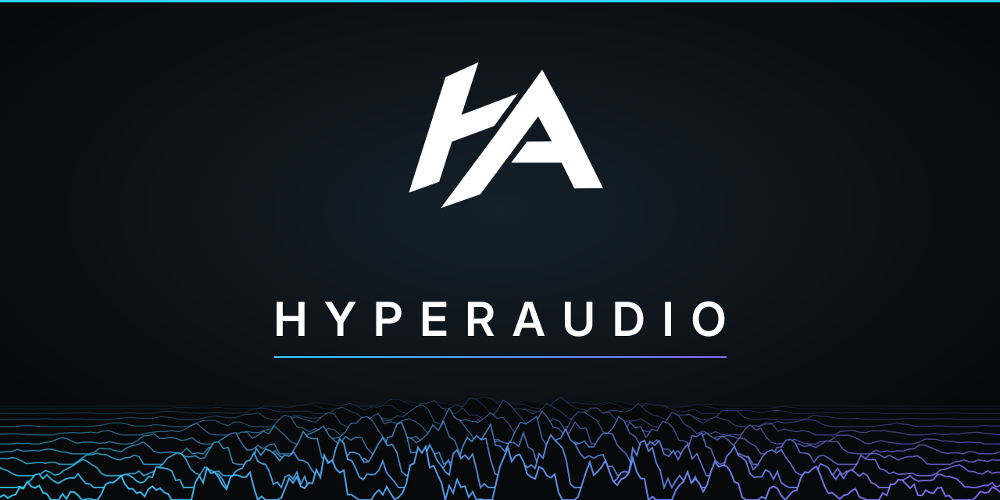
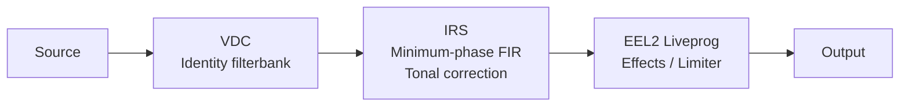
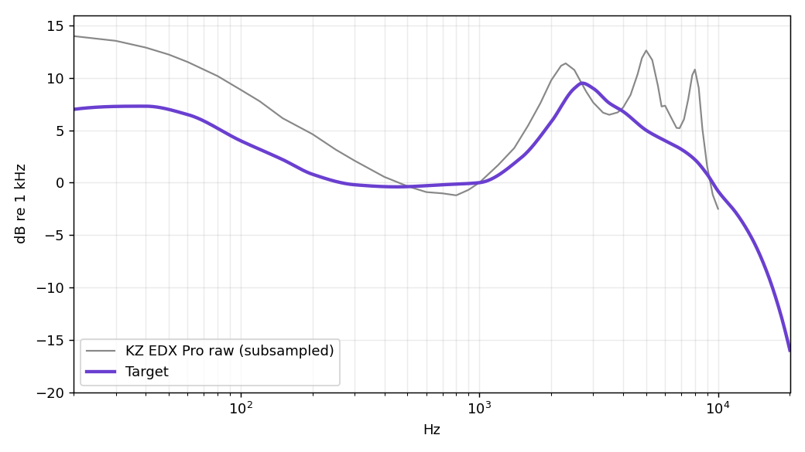
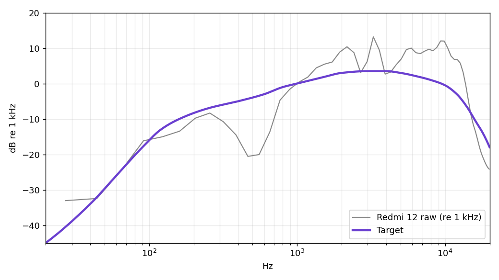
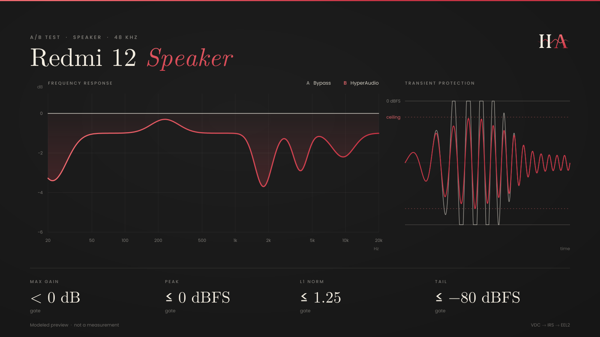
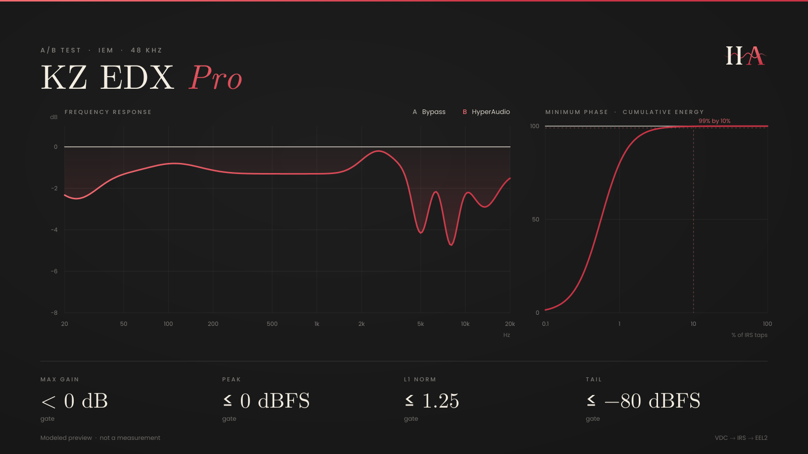

<div align="center">



# HyperAudio

**Sound, in focus.**  
Measurement-driven DSP correction for specific playback systems.

Built for [RootlessJamesDSP](https://github.com/ThePBone/RootlessJamesDSP).

[](https://nmstudioo.github.io/HyperAudioo/)


[Overview](#overview) · [Profiles](#device-profiles) · [Architecture](#processing-architecture) · [Quick start](#quick-start) · [Data](#data-and-targets) · [Add-ons](#add-ons) · [Documentation](#documentation) · [Evidence](#validation-and-evidence) · [Limitations](#known-limitations)



</div>

---

## Overview

HyperAudio publishes correction kits for two playback systems: the **KZ EDX Pro** IEM and the **Redmi 12** speaker. Each kit is scoped to the hardware and the evidence actually available. This is not a general-purpose preset collection.

The two profiles are deployed differently:

| Profile | Configuration | Load | Guide |
|---|---|---|---|
| KZ EDX Pro | VDC → IRS → EEL2 | `HA_IEM_v3.vdc`, `HA_IEM_v3.irs`, `HA_IEM_v3.eel` | [IEM setup guide](edx_pro/Setting_Guide_IEM.md) |
| Redmi 12 | Standalone PEQ and limiter (current) | `HA_Speaker_Master.eel` only | [Speaker setup guide](Redmi_12/Setting_Guide_S.md) |
| Redmi 12 | V6 chain (frozen assets) | `HA_Speaker_Master.vdc` and `HA_Speaker_Master.irs`, plus an EEL | [V6 technical report](Redmi_12/report_Redmi_12.md) |

> [!WARNING]
> The two Speaker configurations are alternatives. Never combine them. The standalone guide excludes the Speaker VDC and IRS.

> [!NOTE]
> **Documentation status.** The V6 report describes `HA_Speaker_Master.eel` as the V6 limiter-only script. The file's own header now identifies it as the standalone PEQ script (V1.0). The V6.1 beta script, `HA_Speaker_Master_BETA.eel`, declares itself a post-IRS stage with an optional PEQ. Which EEL pairs with the V6 VDC and IRS is not settled in the documents, so confirm it before relying on the V6 chain.

| Profiles | Files per chain | Host rate | Tonal stages |
|:--:|:--:|:--:|:--:|
| **2** | **3** | **48 kHz** | **1** |
| KZ EDX Pro, Redmi 12 | VDC, IRS, EEL2 | Verify the running rate | No duplicated EQ |

See the [methodology](docs/methodology.md) for the evidence model and processing rationale.

## Device profiles

### Redmi 12 · Speaker

`Redmi_12/` · V6 frozen, standalone PEQ V1.0

- **IRS:** 8192 taps, 48 kHz, float32 stereo.
- **Standalone setup:** Liveprog PEQ plus a stereo-linked look-ahead limiter. Do not load the VDC or IRS with it.
- **Frozen assets:** the V6 VDC and IRS remain in the repository and are documented in the technical report.

[Standalone setup guide](Redmi_12/Setting_Guide_S.md) · [V6 technical report](Redmi_12/report_Redmi_12.md)

### KZ EDX Pro · IEM

`edx_pro/` · v3 IRS, v5 EEL

- **IRS:** 2048 taps, 48 kHz, float32 stereo. Driver: 24 Ω, 112 dB/mW.
- **EEL paths:** Effects or Limiter only.
- **Voicing:** a labelled design choice, not a measurement-derived target.

[Setup guide](edx_pro/Setting_Guide_IEM.md) · [Technical report](edx_pro/report_EDX_HA.md)

## Processing architecture

The three-file chain below is used by the IEM profile and the frozen Speaker V6 assets. It is not the standalone Speaker PEQ configuration.



> [!IMPORTANT]
> Tonal correction lives in the IRS. The shipped VDC files are identity filterbanks. Never load the same EQ in more than one stage, because it is then applied more than once.

## Quick start

1. **Pick the right guide first.** The IEM guide uses the three-file chain. The Speaker guide uses the standalone EEL only.
2. **Set the host rate to 48 kHz** and verify the running rate. For the IEM chain, set the convolver preamp to 0 dB.
3. **Disable other processing:** extra EQ, bass enhancement, the app's own crossfeed and OEM sound effects.
4. **Load in order.** IEM: DDC (`.vdc`), then Convolver (`.irs`), then Liveprog (`.eel`). Speaker: Liveprog only.
5. **Start at low volume** and confirm the profile and processing mode.

```text
KZ EDX Pro (load all three)         Redmi 12 Speaker (standalone)
edx_pro/                            Redmi_12/
├── HA_IEM_v3.vdc                   └── HA_Speaker_Master.eel
├── HA_IEM_v3.irs
└── HA_IEM_v3.eel
```

## The browser site

[Open HyperAudio](https://nmstudioo.github.io/HyperAudioo/). It is a static site with no build step, and all computation runs locally in the browser.

| Feature | What it does |
|---|---|
| Profiles | Switches between the KZ EDX Pro and Redmi 12 chains. |
| Response chart | Plots the response of the hosted IRS on a log-frequency axis with 1/6-octave smoothing. |
| Quality assurance | Fetches the hosted VDC, IRS and EEL files and checks them in the browser. Downloads are blocked when a check fails. |
| Export | Downloads the profile files or copies a 127-point GraphicEQ curve derived from the IRS. |
| Verification harness | Runs offline checks. This is not native app, ARM or device validation. |
| Documentation reader | Opens repository documents in the site. Example deep link: `#read/docs/methodology.md`. |

## Data and targets

The corrections are fitted to measurement data and target curves kept in [`data/`](data/). Both targets are custom and offline-computed. They are not published standards.

| File | Content |
|---|---|
| [`data/Raw/kz_edx_pro_raw.txt`](data/Raw/kz_edx_pro_raw.txt) | KZ EDX Pro raw response, 695 points |
| [`data/Raw/redmi12_speaker_raw.txt`](data/Raw/redmi12_speaker_raw.txt) | Redmi 12 speaker raw response, 59 points |
| [`data/target/kz_edx_pro_target.txt`](data/target/kz_edx_pro_target.txt) | IEM target, 701 points, dB relative to 1 kHz |
| [`data/target/redmi12_speaker_target.txt`](data/target/redmi12_speaker_target.txt) | Speaker target, 701 points, dB relative to 1 kHz |

<p align="center">
  
  
</p>

Method and principles: [Raw and target curves](data/methodology.md).

## Add-ons

[`addons/`](addons/) holds two optional impulse responses and three EasyEffects reference presets. See the [add-on guide](addons/effects.md).

> [!WARNING]
> The add-on IRS files are not level-matched to the project gates. Measured maximum gain from 20 Hz to 20 kHz: `BBE SonicMax.irs` +7.9 dB (left) and +9.8 dB (right); `EFOtech MLV 01024 (True Stereo, 48kHz).irs` +3.7 to +5.3 dB across its four channels. The project gate is 0 dB. The convolver loads one IRS at a time, so an add-on IRS replaces the tonal-correction IRS rather than adding to it. Lower the volume before trying one.

The three `.json` files cannot be loaded by RootlessJamesDSP. They are references only.

## Documentation

| Reference | Purpose | Read |
|---|---|---|
| [VDC reference](docs/vdc_functions.md) | Shipped VDC structure and evidence boundaries | [Site](https://nmstudioo.github.io/HyperAudioo/#read/docs/vdc_functions.md) |
| [IRS reference](docs/irs_functions.md) | IRS format, metrics and validation | [Site](https://nmstudioo.github.io/HyperAudioo/#read/docs/irs_functions.md) |
| [EEL2 reference](docs/eel_functions.md) | VM syntax, parser constraints and implementation guidance | [Site](https://nmstudioo.github.io/HyperAudioo/#read/docs/eel_functions.md) |
| [System reference](docs/system_full.md) | Architecture, profile state, operation, evidence and limitations | [Site](https://nmstudioo.github.io/HyperAudioo/#read/docs/system_full.md) |
| [Methodology](docs/methodology.md) | Synthesis, gating and evidence method | [Site](https://nmstudioo.github.io/HyperAudioo/#read/docs/methodology.md) |
| [Test report](docs/test_report.md) | Results, scope and open questions | [Site](https://nmstudioo.github.io/HyperAudioo/#read/docs/test_report.md) |
| [Style guide](docs/style_guide.md) | How every document in this repository is written | [Site](https://nmstudioo.github.io/HyperAudioo/#read/docs/style_guide.md) |
| [Repository map](docs/repository_map.md) | Annotated list of every file | [Site](https://nmstudioo.github.io/HyperAudioo/#read/docs/repository_map.md) |
| [Speaker setup guide](Redmi_12/Setting_Guide_S.md) | Redmi 12 standalone installation | [Site](https://nmstudioo.github.io/HyperAudioo/#read/Redmi_12/Setting_Guide_S.md) |
| [IEM setup guide](edx_pro/Setting_Guide_IEM.md) | KZ EDX Pro installation | [Site](https://nmstudioo.github.io/HyperAudioo/#read/edx_pro/Setting_Guide_IEM.md) |
| [Speaker report](Redmi_12/report_Redmi_12.md) | Speaker V6 numerical report | [Site](https://nmstudioo.github.io/HyperAudioo/#read/Redmi_12/report_Redmi_12.md) |
| [IEM report](edx_pro/report_EDX_HA.md) | IEM numerical report | [Site](https://nmstudioo.github.io/HyperAudioo/#read/edx_pro/report_EDX_HA.md) |
| [Raw and target curves](data/methodology.md) | Measurement and target method | [Site](https://nmstudioo.github.io/HyperAudioo/#read/data/methodology.md) |
| [Add-on guide](addons/effects.md) | Optional IRS files and reference presets | [Site](https://nmstudioo.github.io/HyperAudioo/#read/addons/effects.md) |
| [Attribution](ATTRIBUTION.md) | Third-party sources and credits | [Site](https://nmstudioo.github.io/HyperAudioo/#read/ATTRIBUTION.md) |
| [Licence summary](LICENSE.md) | Licence scope and notices | [GitHub](LICENSE.md) |

### Verification harnesses

<p align="center">
  
  
</p>

## Validation and evidence

| Component | Offline / numerical | App or device | Listening |
|---|---|---|---|
| Speaker VDC | `PASS` identity | `USER REPORTED` | `USER REPORTED` |
| Speaker IRS | `PASS` | `USER REPORTED` | `USER REPORTED` |
| Speaker EEL V6 (previous revision) | `PARTIAL` compile, ceiling, bypass; non-finite rerun pending | `USER REPORTED` | `USER REPORTED` |
| Speaker EEL standalone V1.0 | No recorded test | `NOT RUN` | `NOT RUN` |
| IEM VDC | `PASS` identity | `USER REPORTED` | `USER REPORTED` |
| IEM IRS | `PASS` | `USER REPORTED` | `USER REPORTED` |
| IEM EEL effects path | Prior v4 checks: effects, ceiling, bypass, non-finite | `NOT RUN` for v5 | `NOT RUN` |
| IEM EEL v5 mode selector | Source review only; VM retest pending | `NOT RUN` | `NOT RUN` |

**Evidence boundary.** Offline checks use a source-built JamesDSP VM on x86_64. They are not native ARM, RootlessJamesDSP app, target-device or listening tests. Numerically qualified does not mean device validated. Full scope and outstanding work: [test report](docs/test_report.md). Label definitions: [methodology](docs/methodology.md).

## Known limitations

- **Reproducibility:** `iem_build.py`, `generate_irs.py` and the complete source inputs are not included. The published IRS cannot be regenerated from this repository alone.
- **Speaker IRS provenance:** the measurement setup is not documented. If a microphone response was part of the source measurement, it is also in the filter.
- **IEM voicing:** it has no measurement behind it and is a design choice.
- **Spatial processing:** the IEM surround feature is crossfeed plus width, not HRTF virtualisation.
- **ARM:** EEL tests ran on x86_64. The v5 processing-mode selector has not been tested in the VM or on a device.
- **Limiter scope:** sample-peak limiting is not true-peak limiting or driver-excursion protection.
- **Sample rate:** the IRS assets are 48 kHz only. Another host rate changes timing and frequency behaviour.

## Integrity

Verify the shipped assets from the repository root:

```bash
sha256sum -c SHA256SUMS
```

[`SHA256SUMS`](SHA256SUMS) is the source of truth. The table shows it as of commit `80cd3b6`.

<details>
<summary><b>SHA-256 checksums</b></summary>

| File | SHA-256 |
|---|---|
| `Redmi_12/HA_Speaker_Master.vdc` | `933be0b02daead88450f2042065d0fb5a44e77099f8c29a6e37b9669e6a2d6ef` |
| `Redmi_12/HA_Speaker_Master.irs` | `0ba8da0f4351aca761e3c7e39b37bccf9b61403f7d92ed60ecf1b23cda0c7de4` |
| `Redmi_12/HA_Speaker_Master.eel` | `ae3e6d104b328d6379dbf481f0990bf1c6f7042de7dcc6c7c4f2a11bd742cb61` |
| `Redmi_12/HA_Speaker_Master_BETA.eel` | `b19c1755ffbf86278177d4c1b90842c346490cfb5be8c7c8218705aa85c22f73` |
| `edx_pro/HA_IEM_v3.vdc` | `933be0b02daead88450f2042065d0fb5a44e77099f8c29a6e37b9669e6a2d6ef` |
| `edx_pro/HA_IEM_v3.irs` | `b6d751a1613b48569a6ec485f477603172dcc14b0072f0c86c93b4668363b9d5` |
| `edx_pro/HA_IEM_v3.eel` | `4fa7e64bda33b0651c8ce8722c5ee4b9f05aa029aed19444fdfabed22ad020b0` |

The two identity VDC files are byte-identical, so they share one hash.

</details>

## Repository structure

The [repository map](docs/repository_map.md) lists every file with its size and purpose.

<details>
<summary><b>Show repository tree</b></summary>

```text
HyperAudioo/
├── README.md · index.html · ATTRIBUTION.md · SHA256SUMS
├── LICENSE · LICENSE.md · LICENSE-MIT · LICENSE-CC-BY-SA-4.0
├── robots.txt · site.webmanifest · sitemap.xml
├── Redmi_12/
│   ├── HA_Speaker_Master.vdc
│   ├── HA_Speaker_Master.irs
│   ├── HA_Speaker_Master.eel
│   ├── HA_Speaker_Master_BETA.eel
│   ├── Setting_Guide_S.md
│   └── report_Redmi_12.md
├── edx_pro/
│   ├── HA_IEM_v3.vdc
│   ├── HA_IEM_v3.irs
│   ├── HA_IEM_v3.eel
│   ├── Setting_Guide_IEM.md
│   └── report_EDX_HA.md
├── docs/
│   ├── vdc_functions.md · irs_functions.md · eel_functions.md
│   ├── system_full.md · methodology.md · test_report.md
│   └── style_guide.md · repository_map.md
├── data/
│   ├── methodology.md
│   ├── Raw/      kz_edx_pro_raw.txt · redmi12_speaker_raw.txt
│   └── target/   kz_edx_pro_target.txt · redmi12_speaker_target.txt
├── addons/
│   ├── effects.md
│   ├── BBE SonicMax.irs
│   ├── EFOtech MLV 01024 (True Stereo, 48kHz).irs
│   └── Concert Hall.json · GentleDynamics.json · Night Listening.json
└── assets/       site code, images, fonts and harness reports
```

</details>

## Licence

| Scope | Licence |
|---|---|
| EEL2 code (`.eel`) | [MIT](LICENSE-MIT) |
| Audio artifacts (`.irs`, `.vdc`) and reports | [CC BY-SA 4.0](LICENSE-CC-BY-SA-4.0) |

## Credits

See [ATTRIBUTION.md](ATTRIBUTION.md). Presets derive from AutoEq-format data (jaakkopasanen/AutoEq, MIT) via RikudouGoku's database, corroborated by Speaker Ranking. The EEL2 scripts target the VM in RootlessJamesDSP (ThePBone, Apache 2.0). No third-party code is redistributed.

`data/Raw/` contains raw measurement files. Their source and redistribution terms are not documented here. See the attribution notice.

<div align="center">

<sub>Designed &amp; tuned by <b>Noushad M.</b> - © 2026</sub>

</div>
