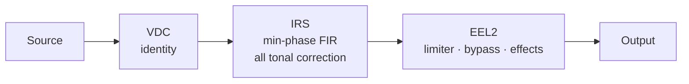

<div align="center">


<br>

**Measurement-driven DSP correction chains for two specific playback systems.**
Built for [RootlessJamesDSP](https://github.com/ThePBone/RootlessJamesDSP).


[Devices](#devices) · [Architecture](#architecture) · [Repository Structure](#repository-structure) · [Quick start](#quick-start) · [Validation](#validation-state) · [Limitations](#known-limitations)

</div>

---

## Overview

Each chain is a matched set: an identity **VDC**, a minimum-phase **IRS** that carries the correction, and an **EEL** script for limiting and optional effects.

This is **not** a preset collection. Every claim in this repository carries an evidence label, and unverified items are marked as such. See [`docs/methodology.md`](docs/methodology.md).

## Devices

| | Device | Chain | IRS | State |
|---|---|---|---|---|
| 🔊 | **Redmi 12** speaker | [`Redmi_12/`](Redmi_12/) | 8192 taps · 48 kHz | Experimental |
| 🎧 | **KZ EDX Pro** IEM (24 Ω, 112 dB/mW) | [`edx_pro/`](edx_pro/) | 2048 taps · 48 kHz | Experimental |

## Architecture



> [!IMPORTANT]
> Tonal correction lives **only in the IRS**. Never load the same EQ in both the VDC and the convolver, because it applies twice.

## Repository Structure

```
hyperaudioo/
├── LICENSE                   Points to the two license files
├── LICENSE-MIT               Code (EEL2)
├── LICENSE-CC-BY-SA-4.0      Audio artifacts (.irs, .vdc, reports)
├── ATTRIBUTION.md            AutoEq, Speaker Ranking, RootlessJamesDSP
├── README.md                 This file
├── index.html                Interactive A/B test harness (see docs)
│
├── Redmi_12/
│   ├── - HA™ S Master.eel               Post-IRS transparent limiter
│   ├── - HA™ S Master.irs               8192-tap FIR correction
│   ├── - HA™ S Master.vdc               Identity DDC (no correction)
│   ├── Setting_Guide_S.md               On-device setup instructions
│   └── report_Redmi_12.md               Numerical report
│
├── edx_pro/
│   ├── - HA IEM v3.irs                 2048-tap minimum-phase FIR correction
│   ├── - HA IEM v3.eel                 Limiter, bypass and effects (EEL2)
│   ├── - HA IEM v3.vdc                 Identity DDC (no correction)
│   ├── Setting_Guide_IEM.md            On-device setup instructions
│   └── report_EDX_HA.md                Numerical report
│
├── docs/
│   ├── methodology.md                Synthesis, gating, validation method
│   └── test_report.md                Test results and open questions
│
└── assets/
    ├── banner.svg                    GitHub repo cover
    ├── logo.svg                      Brand mark (favicon, avatar)
    ├── Speaker_AB_Harness.webp       Speaker AB Harness Report
    ├── IEM_AB_Harness.webp           IEM AB Harness Report
    ├── script.js                     Core JavaScript
    └── style.css                     Core Style CSS
```

## Quick start

1. **Host rate 48 kHz.** Both IRS files are 48 kHz only. Verify the *running* rate in Rootless.
2. **Disable** every other EQ, bass boost and OEM sound effect.
3. **Load in this order:** DDC (`.vdc`) → Convolver (`.irs`, preamp **0 dB**) → Liveprog (`.eel`).
4. **Start at low volume.**

<table>
<tr>
<td width="50%" valign="top">

### 🔊 Redmi 12
`Redmi_12/`
- `- HA™ S Master.vdc`
- `- HA™ S Master.irs`
- `- HA™ S Master.eel`

[Setting guide](Redmi_12/Setting_Guide_S.md) · [Report](Redmi_12/report_Redmi_12.md)

</td>
<td width="50%" valign="top">

### 🎧 KZ EDX Pro
`edx_pro/`
- `- HA IEM v3.vdc`
- `- HA IEM v3.irs`
- `- HA IEM v3.eel`

[Setting guide](edx_pro/Setting_Guide_IEM.md) · [Report](edx_pro/report_EDX_HA.md)

</td>
</tr>
</table>

## A/B harness

Level-matched blind comparison. Open [`index.html`](index.html) or the hosted page: **https://nmstudioo.github.io/HyperAudioo**

<p align="center">
  
  
</p>

## Validation state

| Component | Offline checks | App / device | Listening |
|---|:-:|:-:|:-:|
| Speaker IRS | ✅ PASS | ⛔ NOT RUN | ⛔ NOT RUN |
| Speaker EEL | ✅ compile · ⚠️ NaN guard FAIL (x86) | ⛔ NOT RUN | ⛔ NOT RUN |
| Speaker VDC | ✅ identity | 🟡 USER REPORTED | — |
| IEM IRS | ✅ PASS | ⛔ NOT RUN | ⛔ NOT RUN |
| IEM EEL | ✅ PASS | ⛔ NOT RUN | ⛔ NOT RUN |
| IEM VDC | ✅ identity | — | — |

*Numerically qualified* never implies device testing or listening. Details: [`docs/test_report.md`](docs/test_report.md).

## Integrity

Verify downloads with `sha256sum`.

```
Redmi_12/- HA™ S Master.vdc
    933be0b02daead88450f2042065d0fb5a44e77099f8c29a6e37b9669e6a2d6ef
Redmi_12/- HA™ S Master.irs
    46519e592cc229baabd37b58c04e60c02da47bf261f9b1566b8808b19127105f
Redmi_12/- HA™ S Master.eel
    4def69dbbe702d4784dd629f5038c0136e4368f62be8e87d555c6fb39892fe14

edx_pro/- HA IEM v3.vdc
    933be0b02daead88450f2042065d0fb5a44e77099f8c29a6e37b9669e6a2d6ef
edx_pro/- HA IEM v3.irs
    b6d751a1613b48569a6ec485f477603172dcc14b0072f0c86c93b4668363b9d5
edx_pro/- HA IEM v3.eel   (limiter-only v3 script)
    f48ee0183045cbc067a6d2308334e9365b5262c2961ca78cbc40512dc6e7e894
edx_pro/- HA IEM v3.eel   (if shipping the v4 script with effects)
    92cadeaedcfba89df109ff1d113bd1d1b80c8b0493c6e0f7908fb0b9c41dc361
```

## Known limitations

- **Speaker data provenance is unknown.** If a mic's response is inside the measurement, it is inside the filter.
- **IEM voicing has no measurement behind it.** It is a labelled design choice.
- **Not Dolby.** The IEM surround is crossfeed plus width, not HRTF virtualisation.
- **Speaker EEL NaN guard** can latch on the x86 test VM; ARM unknown.
- **Sample-peak limiting** is not true-peak or excursion protection.
- **48 kHz only.** At any other rate the IRS is stretched or shortened.

## License

| Scope | License |
|---|---|
| Code (`.eel`) | [MIT](LICENSE-MIT) |
| Audio artifacts (`.irs`, `.vdc`, reports) | [CC BY-SA 4.0](LICENSE-CC-BY-SA-4.0) |

## Credits

See [`ATTRIBUTION.md`](ATTRIBUTION.md). Presets derive from AutoEq-format data (jaakkopasanen/AutoEq, MIT) via RikudouGoku's database, corroborated by Speaker Ranking. EEL2 scripts target the VM in RootlessJamesDSP (ThePBone, Apache 2.0). No third-party code or raw measurements are redistributed.

<div align="center">
<br>

</div>
