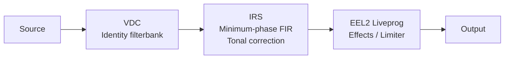

<div align="center">


# HyperAudio

**Sound, in focus.**  
Measurement-driven DSP correction for specific playback systems.

Built for [RootlessJamesDSP](https://github.com/ThePBone/RootlessJamesDSP).

[](https://nmstudioo.github.io/HyperAudioo/)


[Overview](#overview) · [Profiles](#device-profiles) · [Architecture](#processing-architecture) · [Quick start](#quick-start) · [Documentation](#documentation) · [Validation](#validation--evidence) · [Limitations](#known-limitations)


</div>

---

## Overview

HyperAudio publishes two device profiles, but their deployment guidance is not identical. The KZ EDX Pro uses the identity **VDC → minimum-phase IRS → EEL2** chain. The Redmi 12 directory retains the frozen V6 three-file assets, while its current [Speaker setup guide](Redmi_12/Setting_Guide_S.md) documents a separate **standalone EEL2 PEQ** configuration. These Speaker configurations are alternatives and must not be combined.

This is **not** a general-purpose preset collection. Profiles, measurements, implementation details, and test claims are scoped to the hardware and evidence actually available.

| **2** device profiles | **3** files per chain | **48 kHz** IRS host rate | **1** tonal-correction stage |
|:--:|:--:|:--:|:--:|
| 2 device profiles | Profile-specific assets | Verify the running rate | No duplicated EQ |

See [methodology](docs/methodology.md) for the evidence model and processing rationale.

## Device profiles

<table>
<tr>
<td width="50%" valign="top">

### Redmi 12 · Speaker

<sub><code>Redmi_12/</code> · <b>V6 · FROZEN</b></sub>

**8192-tap · 48 kHz IRS**

**Important configuration split:** the guide is for standalone Liveprog PEQ + limiter. It explicitly replaces the older VDC → IRS → limiter chain; do not load the VDC or IRS with this guide. The frozen V6 three-file assets remain in the repository and are documented separately in the technical report.

[Standalone setting guide](Redmi_12/Setting_Guide_S.md) · [V6 technical report](Redmi_12/report_Redmi_12.md)

</td>
<td width="50%" valign="top">

### KZ EDX Pro · IEM

<sub><code>edx_pro/</code> · <b>v3 IRS · v5 EEL</b></sub>

**2048-tap · 48 kHz IRS · 24 Ω · 112 dB/mW**

Selectable Effects or Limiter-only paths. The IEM voicing is a labelled design choice, not a measurement-derived target.

[Setting guide](edx_pro/Setting_Guide_IEM.md) · [Technical report](edx_pro/report_EDX_HA.md)

</td>
</tr>
</table>

## Processing architecture

The following is the three-file architecture used by the IEM profile and the frozen Speaker V6 asset set. **It is not the current standalone Speaker PEQ guide configuration.**



> **Important:** Tonal correction lives in the IRS. The VDC assets are identity filterbanks. Do not load the same EQ in multiple stages; doing so applies correction more than once.

## Quick start

1. **Choose the correct profile guide first.** The IEM guide uses the three-file chain below. The Speaker guide uses standalone Liveprog PEQ and explicitly excludes its VDC and IRS files.
2. For the IEM chain, set the host rate to **48 kHz**, verify the running rate, and set convolver preamp to **0 dB**.
3. Disable other EQ, bass enhancement, and OEM sound effects that would stack processing.
4. Load the IEM chain in order: DDC (`.vdc`) → Convolver (`.irs`) → Liveprog (`.eel`). For the Speaker, follow [its standalone guide](Redmi_12/Setting_Guide_S.md) instead.
5. **Start at low volume** and confirm the selected profile and processing mode.

<table>
<tr>
<td width="50%" valign="top">

**Redmi 12 Speaker**

```text
Redmi_12/
├── HA_Speaker_Master.vdc
├── HA_Speaker_Master.irs
└── HA_Speaker_Master.eel
```

</td>
<td width="50%" valign="top">

**KZ EDX Pro**

```text
edx_pro/
├── HA_IEM_v3.vdc
├── HA_IEM_v3.irs
└── HA_IEM_v3.eel
```

</td>
</tr>
</table>

## The browser site

**[Open HyperAudio](https://nmstudioo.github.io/HyperAudioo/)** — a static site with no build step. Computation runs locally in the browser.

| Feature | What it does |
|---|---|
| Profiles | Switch between the KZ EDX Pro and Redmi 12 speaker chains. |
| Response chart | Displays response derived from the hosted IRS, with log-frequency scale and 1/6-octave smoothing. |
| Quality assurance | Fetches and checks hosted VDC, IRS, and EEL assets in the browser. Downloads are blocked when QA fails. |
| Export | Downloads the three profile files or copies a 127-point GraphicEQ curve derived from the IRS. |
| Verification harness | Runs offline checks. This is not native app, ARM, or device validation. |
| Documentation reader | Opens repository documents in the site. Example deep link: `#read/docs/methodology.md`. |

## Documentation

| Reference | Purpose | Read |
|---|---|---|
| [VDC reference](docs/vdc_functions.md) | Shipped VDC structure and evidence boundaries | [Site](https://nmstudioo.github.io/HyperAudioo/#read/docs/vdc_functions.md) |
| [IRS functions](docs/irs_functions.md) | IRS format, metrics, and validation | [Site](https://nmstudioo.github.io/HyperAudioo/#read/docs/irs_functions.md) |
| [EEL2 functions](docs/eel_functions.md) | VM syntax, parser constraints, and implementation guidance | [Site](https://nmstudioo.github.io/HyperAudioo/#read/docs/eel_functions.md) |
| [System reference](docs/system_full.md) | Current architecture, profile state, operation, evidence, and limitations | [Site](https://nmstudioo.github.io/HyperAudioo/#read/docs/system_full.md) |
| [Methodology](docs/methodology.md) | Synthesis, gating, and evidence method | [Site](https://nmstudioo.github.io/HyperAudioo/#read/docs/methodology.md) |
| [Test report](docs/test_report.md) | Results, scope, and open questions | [Site](https://nmstudioo.github.io/HyperAudioo/#read/docs/test_report.md) |
| [Speaker setup](Redmi_12/Setting_Guide_S.md) | Redmi 12 installation instructions | [Site](https://nmstudioo.github.io/HyperAudioo/#read/Redmi_12/Setting_Guide_S.md) |
| [IEM setup](edx_pro/Setting_Guide_IEM.md) | KZ EDX Pro installation instructions | [Site](https://nmstudioo.github.io/HyperAudioo/#read/edx_pro/Setting_Guide_IEM.md) |
| [Speaker report](Redmi_12/report_Redmi_12.md) | Speaker-chain numerical report | [Site](https://nmstudioo.github.io/HyperAudioo/#read/Redmi_12/report_Redmi_12.md) |
| [IEM report](edx_pro/report_EDX_HA.md) | IEM-chain numerical report | [Site](https://nmstudioo.github.io/HyperAudioo/#read/edx_pro/report_EDX_HA.md) |
| [Attribution](ATTRIBUTION.md) | Third-party sources and credits | [Site](https://nmstudioo.github.io/HyperAudioo/#read/ATTRIBUTION.md) |
| [License notes](LICENSE.md) | Project license scope and notices | [GitHub](LICENSE.md) |

### Verification harnesses

<p align="center">
  
  
</p>

## Validation & evidence

| Component | Offline / numerical | App or device | Listening |
|---|---|---|---|
| Speaker VDC | **PASS** · identity | **USER REPORTED** | **USER REPORTED** |
| Speaker IRS | **PASS** | **USER REPORTED** | **USER REPORTED** |
| Speaker EEL | **PARTIAL** · compile, ceiling, bypass; non-finite rerun pending | **USER REPORTED** | **USER REPORTED** |
| IEM VDC | **PASS** · identity | — | — |
| IEM IRS | **PASS** | **NOT RUN** | **NOT RUN** |
| IEM EEL effects path | Prior v4 checks: effects, ceiling, bypass, non-finite | **NOT RUN** for current v5 | **NOT RUN** |
| IEM EEL v5 mode selector | Source review only; VM retest pending | **NOT RUN** | **NOT RUN** |

**Evidence boundary:** Offline checks use a source-built JamesDSP VM on x86_64. They are not native ARM, RootlessJamesDSP app, target-device, or listening tests. “Numerically qualified” does not imply device validation. Full scope and outstanding work: [test report](docs/test_report.md).

## Known limitations

- **Reproducibility:** `iem_build.py`, `generate_irs.py`, and complete source inputs are not included. The published IRS cannot be regenerated from this repository alone.
- **Speaker IRS provenance:** The measurement setup is not documented here. If a microphone response was included in the source measurement, it is also present in the resulting filter.
- **IEM voicing:** The IEM voicing has no measurement behind it; it is explicitly a design choice.
- **Spatial processing:** The IEM surround feature is crossfeed plus width, not HRTF virtualisation.
- **ARM compatibility:** EEL tests were run on x86_64. The v5 processing-mode selector has not yet been VM- or device-tested.
- **Limiter scope:** Sample-peak limiting is not true-peak limiting or driver-excursion protection.
- **Sample rate:** The IRS assets are 48 kHz only. Using another host rate changes the effective impulse-response timing and frequency behaviour.

## Integrity

Verify downloaded files with `sha256sum`.

<details>
<summary><b>SHA-256 checksums</b></summary>

```text
Redmi_12/HA_Speaker_Master.vdc
    933be0b02daead88450f2042065d0fb5a44e77099f8c29a6e37b9669e6a2d6ef
Redmi_12/HA_Speaker_Master.irs
    0ba8da0f4351aca761e3c7e39b37bccf9b61403f7d92ed60ecf1b23cda0c7de4
Redmi_12/HA_Speaker_Master.eel
    e5cfbc49cb82aad8d3c45da5ca27715a9712639cb1f41aa3dce2a9677c903af4

edx_pro/HA_IEM_v3.vdc
    933be0b02daead88450f2042065d0fb5a44e77099f8c29a6e37b9669e6a2d6ef
edx_pro/HA_IEM_v3.irs
    b6d751a1613b48569a6ec485f477603172dcc14b0072f0c86c93b4668363b9d5
edx_pro/HA_IEM_v3.eel
    3efa4976c3e9788faafa0225a9bcffa5944c04cb3d1bbfd5b64ce3a6d7d56b17
```

</details>

## Repository structure

<details>
<summary><b>Show repository tree</b></summary>

```text
HyperAudioo/
├── README.md
├── index.html
├── ATTRIBUTION.md
├── LICENSE
├── LICENSE-MIT
├── LICENSE-CC-BY-SA-4.0
├── LICENSE.md
├── Redmi_12/
│   ├── HA_Speaker_Master.vdc
│   ├── HA_Speaker_Master.irs
│   ├── HA_Speaker_Master.eel
│   ├── HA_Speaker_Master_BETA.eel
│   ├── Setting_Guide_S.md
│   └── report_Redmi_12.md
├── edx_pro/
│   ├── HA_IEM_v3.vdc
│   ├── HA_IEM_v3.irs
│   ├── HA_IEM_v3.eel
│   ├── Setting_Guide_IEM.md
│   └── report_EDX_HA.md
├── docs/
│   ├── vdc_functions.md
│   ├── irs_functions.md
│   ├── eel_functions.md
│   ├── system_full.md
│   ├── methodology.md
│   └── test_report.md
├── assets/
│   ├── logo.svg
│   ├── banner.svg
│   ├── style.css
│   ├── script.js
│   ├── docs.js
│   ├── fonts/
│   └── verification harness graphics
└── .github/workflows/
    └── ci.yml
```

</details>

## Licensing

| Scope | License |
|---|---|
| EEL2 code (`.eel`) | [MIT](LICENSE-MIT) |
| Audio artifacts (`.irs`, `.vdc`) and reports | [CC BY-SA 4.0](LICENSE-CC-BY-SA-4.0) |

## Credits

See [ATTRIBUTION.md](ATTRIBUTION.md). Presets derive from AutoEq-format data (jaakkopasanen/AutoEq, MIT) via RikudouGoku's database, corroborated by Speaker Ranking. EEL2 scripts target the VM in RootlessJamesDSP (ThePBone, Apache 2.0). No third-party code or raw measurements are redistributed.

<div align="center">

<sub>Designed &amp; tuned by <b>Noushad M.</b> · © 2026</sub>

</div>
